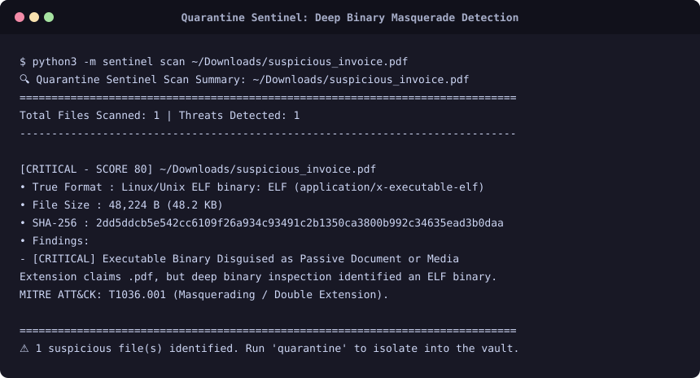
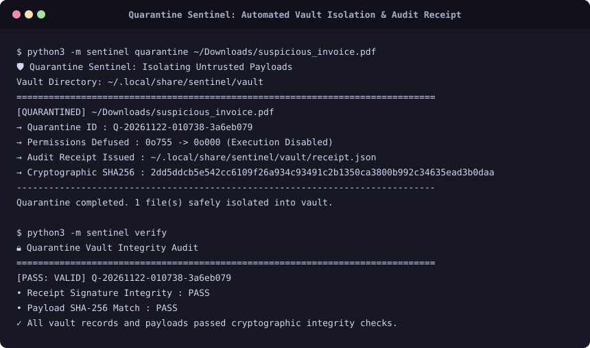

# Quarantine Sentinel

A Python project for inspecting files and moving selected files into a quarantine vault, with receipts and a restore workflow. It uses file characteristics and rules to identify items for review.

## Visual Walkthrough & Execution Previews

### 1. Deep Binary Masquerade Detection


### 2. Automated Vault Isolation & Audit Receipt


## Getting started

From the repository root, use Python 3.9 or later (standard library only, zero external pip dependencies):

```sh
python3 -m sentinel --help
python3 -m sentinel scan /path/to/file --json
```

The `scan` command accepts a file or directory. The CLI also offers `quarantine`, `receipts`, `receipt`, `verify` and `restore`; see each subcommand’s `--help` for options.

```sh
python3 -m sentinel quarantine /path/to/file --dry-run
python3 -m sentinel receipts
```

Quarantine moves selected files and changes their permissions; restore moves a payload to a destination. The quarantine dry run does not move payloads, but initializes the vault and may create its directories. Review the target, vault location, permissions and recovery process before use.

## Scope

File heuristics can miss threats or flag harmless files. A clean result is not proof that a file is safe. Receipts and hash checks can help investigate changes, but do not make evidence or storage immutable. Handle untrusted files carefully and validate results independently.

## Tests & CI Verification

The repository includes [tests](tests/), runnable with:

```sh
python3 -m unittest discover -s tests -v
```

All 34 test cases run across Python 3.9 through 3.13 on Ubuntu and macOS in GitHub Actions CI (`.github/workflows/ci.yml`).

## Engineering Standards & Magi Bible 📖

All code, documentation, and operational protocols follow the open-source **Magi AI Engineering Standard**:
- **[MAGI_LOOK_HERE.md](MAGI_LOOK_HERE.md):** Contributor & autonomous agent operational rules, code of conduct, and verification criteria.
- **[MAGI_BIBLE.md](MAGI_BIBLE.md):** The Universal Magi Bible establishing Rule 16 commentary ($\ge 25\%$), visual walkthrough previews, fail-closed boundaries, and standard library reliance.

## License

[MIT](LICENSE)
